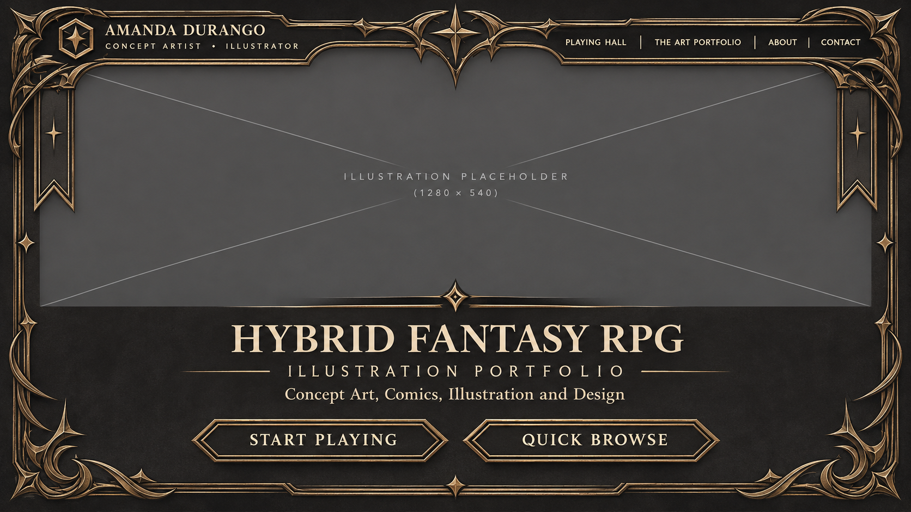
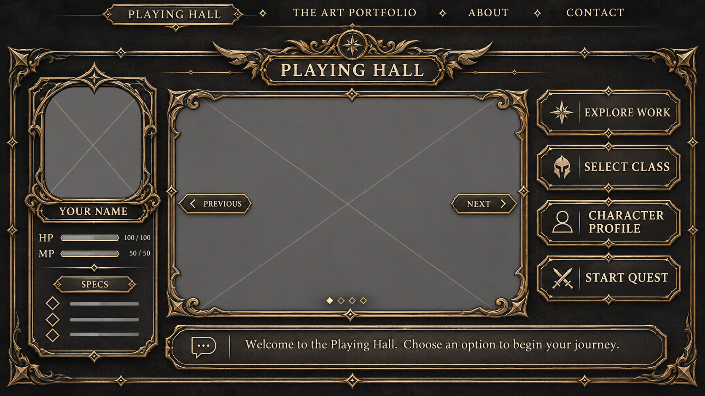
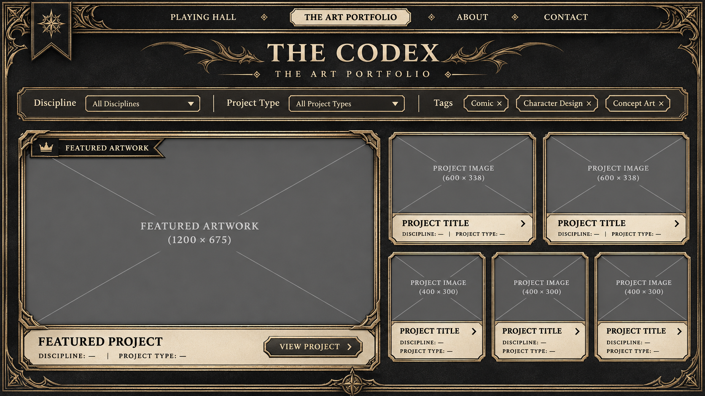
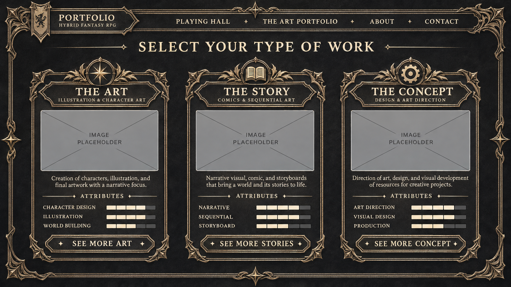
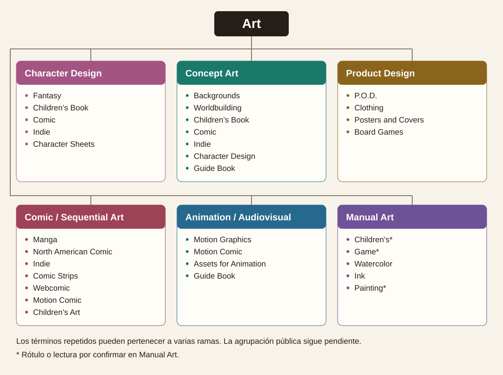

# Hybrid Fantasy RPG Portfolio
## DRP consolidado · V4.1 · 11 de noviembre de 2026

Portafolio profesional interactivo de Amanda Durango para dirección de arte, estudios de videojuegos, editoriales, agencias y clientes. La interfaz combina menús y fichas de JRPG clásico con marcos ornamentales de dark fantasy moderno. La presentación editorial da prioridad a la obra, las especialidades y la información para contratar. La galería y el contacto deben estar disponibles desde la navegación global, sin tutoriales, bloqueos ni progresión obligatoria.

Base documental: registro textual V4.1, transcripción de correcciones V3→V4 y DRP v1.0 del [chat original](chatgpt-conversation://6af47ffd-094c-83e9-8119-a2bd8129bffd). V4.1 prevalece donde hay diferencias. La composición se apoya en los cuatro wireframes regenerados y el mockup HTML navegable de la sección 7.

## 1. Decisiones y pendientes

| Estado | Decisión |
| --- | --- |
| Confirmado explícitamente en V4.1 | El hub se llama **Playing Hall**, la galería **The Art Portfolio** y la clasificación usa **etiquetas profesionales**. Retirar Guild Hall y The Codex como nombres principales y Main Quest, Side Quest, Character Encounter y Worldbuilding como filtros principales. |
| Conservado de los wireframes | Intro Hybrid con dos accesos. Hall con retrato y HP/MP a la izquierda, obra central dominante, comandos a la derecha y diálogo inferior del personaje. Galería editorial mixta con pieza grande a la izquierda y piezas secundarias a la derecha en desktop. Selector con tres tarjetas verticales ornamentadas. |
| Dirección de trabajo V4.1 | **Select Your Type of Work** presenta **The Art**, **The Story** y **The Concept**. Los nombres y CTA se usan como texto de trabajo sujeto a revisión editorial. **START PLAYING** reemplaza Enter the Guild. **QUICK BROWSE** conserva su función y su etiqueta provisional. |
| Confirmado para la primera entrega | Next.js App Router, TypeScript y Tailwind CSS. Construir Intro Hybrid y Playing Hall, navegación compartida y destinos provisionales. Usar placeholders para obra y retrato. Flujo AI Studio → commit GitHub → descargar o clonar repo → abrir en Codex. |
| Pendiente editorial y visual | Marca definitiva, titular de Intro, etiqueta final de Quick Browse, textos de diálogos, retrato, ilustraciones, proyectos y biografía verificados, paleta y tipografías finales, revisión visual de About y Contact. La bajada propuesta de Intro es «Concept Art, Comics, Illustration and Design». Retirar «for Fantastic Worlds». «Graphic Storyteller» queda por confirmar. |
| Pendiente funcional | Taxonomía completa, valores y significado de HP/MP, lista definitiva de Specs, comportamiento definitivo del carrusel, campos y obligatoriedad del formulario, correo público, envío, tratamiento de datos, dominio y hosting. |
| Propuesta técnica para arrancar | URLs de la tabla, contenido local tipado, filtros por query string y carrusel manual sin autoplay. Estas decisiones son revisables. |

## 2. Vistas, contenido y conexiones

| Vista y ruta propuesta | Contenido y jerarquía | Conexiones | Fase inicial |
| --- | --- | --- | --- |
| Intro Hybrid · `/` | Encabezado con Amanda Durango y profesión, título, bajada profesional provisional, hero para ilustración y marco ornamental. | START PLAYING → `/hall`. QUICK BROWSE → `/portfolio`. Menú global disponible. | Completa con placeholders. |
| Playing Hall · `/hall` | Ilustración central en carrusel, retrato RPG, ficha con HP/MP decorativos, Specs, cuatro comandos y diálogo inferior con icono, bienvenida y explicación breve en voz del personaje. Specs anotadas para revisión: Concept Art, Comic, Animation, Product Design y Character Design. | EXPLORE WORK → `/portfolio`. SELECT CLASS → `/work-types`. CHARACTER PROFILE → `/about`. START QUEST → `/contact`. | Completa con placeholders y diálogo provisional. |
| Select Your Type of Work · `/work-types` | Tres tarjetas con emblema, título, subtítulo, imagen, descripción y atributos. The Art abarca ilustración, diseño de personajes y desarrollo visual. The Story abarca cómics, narrativa visual y storyboard. The Concept abarca conceptualización, diseño y dirección de arte. | SEE MORE ART / STORIES / CONCEPT → `/portfolio?specialty=art`, `story` o `concept` respectivamente, aplicando el filtro en la fase de galería. | Destino provisional. |
| The Art Portfolio · `/portfolio` | Proyecto destacado, tarjetas secundarias con imagen y descripción, filtros por disciplina y tipo. Comic, Character Design y Concept Art son ejemplos registrados. Añadir Illustration, Graphic Design o Storyboard cuando el catálogo lo justifique. | Tarjeta → `/portfolio/[slug]`. Filtros actualizan URL y resultados. Restablecer filtros vuelve a `/portfolio`. | Destino provisional, con acceso directo desde Intro y Hall. |
| Project Detail · `/portfolio/[slug]` | Caso de estudio con título, hero, galería, categorías, rol, descripción, proceso, entregables y resultados documentados. | Volver a la galería, idealmente conservando filtros, y abrir proyectos relacionados. Slug desconocido → 404. | Contrato de ruta reservado. Sin fichas de proyectos de ejemplo. |
| About · `/about` | Ficha profesional inspirada en RPG con retrato, biografía, habilidades, especialidades, experiencia, herramientas y logros documentados. | CTA → `/contact`. | Destino provisional. |
| Contact · `/contact` | Solicitud de proyecto o presupuesto. Campos propuestos: nombre, correo, tipo de proyecto, brief, presupuesto aproximado y plazo. Alternativa por correo cuando se confirme una dirección pública. | Envío validado con confirmación real, error recuperable y alternativa de correo. | Destino provisional sin formulario de envío. |

El layout raíz comparte encabezado y navegación directa. Intro y Hall mantienen URLs propias y funcionan al recargar o usar el historial. El menú global expone Hall, especialidades, galería, About y Contact, con inicio mediante la identidad. Project Detail se alcanza desde proyectos publicados.

## 2.1. Referencia de taxonomía · Estilos wireframe.jpg

El esquema manuscrito agrupa el trabajo bajo **Art** en seis familias. Esta transcripción conserva los cruces entre ramas y normaliza la ortografía de los rótulos en inglés. La imagen se incorpora como referencia editorial para el catálogo, con nombres públicos y mapeo a especialidades pendientes de revisión.

| Familia del esquema | Entradas asociadas |
| --- | --- |
| Character Design | Fantasy, Children’s Book, Comic, Indie, Character Sheets. |
| Concept Art | Backgrounds, Worldbuilding, Children’s Book, Comic, Indie, Character Design, Guide Book. |
| Product Design | P.O.D., Clothing, Posters and Covers, Board Games. |
| Comic / Sequential Art | Manga, North American Comic, Indie, Comic Strips, Webcomic, Motion Comic, Children’s Art. |
| Animation / Audiovisual | Motion Graphics, Motion Comic, Assets for Animation, Guide Book. |
| Manual Art | Children’s y Game (rótulos por precisar), Watercolor, Ink, Painting (lectura provisional junto a una tachadura). |

- **Cruces.** Motion Comic aparece en Comic / Sequential Art y Animation / Audiovisual. Guide Book aparece en Concept Art y Animation / Audiovisual. Character Design figura como familia y como entrada de Concept Art. El catálogo podrá representar estos cruces mediante relaciones múltiples y etiquetas con identificadores estables.
- **Facetas propuestas.** Distinguir disciplinas, formatos o entregables, géneros, ámbitos y técnicas. Por ejemplo, Watercolor e Ink describen técnicas, Character Sheets describe un entregable y Fantasy describe un género. Worldbuilding se registra aquí como término profesional de Concept Art, subordinado a la taxonomía de V4.1.
- **Pendientes.** Validar los rótulos abreviados o ambiguos, el alcance de P.O.D. y su relación con Clothing, y el mapeo de cada familia a The Art, The Story y The Concept. Los colores del dibujo identifican ramas en la referencia.
- **Aplicación.** Esta información alimenta el futuro catálogo y sus filtros. En la primera fase solo se documenta y se conserva la ruta provisional de la galería.

## 3. Arquitectura y datos propuestos

- `app/layout.tsx` contiene shell, navegación y metadatos base. `app/page.tsx` y `app/{hall,work-types,portfolio,about,contact}/page.tsx` contienen las vistas. Añadir `app/portfolio/[slug]/page.tsx` al integrar el catálogo. Mantener estilos globales y tokens en `app/globals.css`.
- `components/` contiene componentes compartidos. `content/` contiene perfil, navegación, diálogo, especialidades y datos editoriales. `public/` contiene assets entregados. Usar componentes de servidor por defecto y componentes de cliente para carrusel y controles que requieran estado local.
- Definir tokens CSS para superficies, texto, bordes, acento, espaciado, tipografía, foco y movimiento. Usar Tailwind para componer layouts y estados sobre esos tokens. Registrar las decisiones visuales de la fase como provisionales.
- Modelar solo los tipos que use la fase inicial en el código. El resto de este contrato guía la ampliación.

| Modelo | Campos y reglas |
| --- | --- |
| Artwork / Placeholder | Obra con id, src, alt, ancho, alto y caption opcional. Placeholder con id, etiqueta y proporción, sin URL de imagen ficticia. Mantener proporción y composición de obras reales. |
| ArtistProfile | Nombre, bajada provisional, retrato, specs y diálogo de bienvenida. Biografía, herramientas, experiencia y logros se agregan con contenido aprobado. |
| HallSlide / HallCommand | Slide con id, asset y título opcional. Comando con label y href. HP/MP es presentación decorativa y sus valores se mantienen ilustrativos. |
| Specialty | Id estable `art`, `story` o `concept`, título, subtítulo, descripción, emblema, asset, atributos y CTA. El id alimenta el filtro y admite proyectos en varias especialidades. |
| Project | Slug único, título, resumen, disciplinas, tipo de proyecto, specialtyIds, tags profesionales, rol, hero, galería, proceso y entregables. Resultados y relatedSlugs opcionales. Separar el destacado editorial del tipo y de las disciplinas. |
| PortfolioFilters | Parámetros opcionales `specialty`, `discipline` y `type` con valores normalizados. Combinar filtros activos, mostrar estado vacío y ofrecer restablecerlos. Validar valores contra la taxonomía configurada. |
| ContactInquiry | Nombre, email, tipo y brief. Presupuesto y plazo sujetos a revisión. En la fase de envío, validar en servidor y confirmar éxito tras respuesta del servicio. Conservar datos escritos si el envío falla. |

## 4. Componentes y requisitos

| Sistema | Responsabilidad |
| --- | --- |
| GlobalNavigation, SectionHeading, OrnateFrame, RPGPanel | Navegación semántica y adaptable, jerarquía de texto, marcos reutilizables y decoración que no invada el contenido. |
| RPGCommandButton, CharacterPortrait, CharacterStatus, DialogueBox | Comandos como enlaces cuando cambian de ruta, retrato, Specs y HP/MP, diálogo contextual breve. Botones para acciones locales. |
| ArtworkPlaceholder, ArtworkCarousel | Reservar proporciones sin saltos, identificar assets pendientes, controles anterior/siguiente y estado visible de la diapositiva. |
| ClassCard, FeaturedProject, ProjectCard, PortfolioFilters, ProjectGallery, ContactForm | Componentes de fases posteriores para especialidades, catálogo, detalle y consultas. |

- **Visual.** Marcos ornamentales, esquinas grabadas, emblemas y paneles inspirados en RPG. Dar aire al contenido editorial, mantener la ilustración como elemento principal y moderar efectos de brillo y movimiento.
- **Responsive.** Desktop es referencia visual. En tablet adaptar columnas al espacio. En móvil apilar paneles, priorizar obra y acciones y conservar controles cómodos al tacto. Evitar recortes de obra y desbordes horizontales.
- **Accesibilidad.** Landmarks y encabezados semánticos, foco visible, contraste legible, navegación por teclado, controles etiquetados, texto alternativo para obra real y funcionamiento sin hover. Ocultar ornamentos puramente decorativos a tecnologías de asistencia y respetar `prefers-reduced-motion`.
- **Rendimiento y SEO.** Renderizar contenido indexable con metadatos por vista, optimizar imágenes reales y diferir las secundarias cuando corresponda. Limitar JavaScript de cliente a interacciones. Añadir metadatos sociales al publicar fichas reales.
- **Contenido y alcance.** Usar skeletons estáticos proporcionales para assets faltantes. Evitar stock, generación de imágenes y credenciales o proyectos ficticios. Mantener contenido local en la primera fase. Catálogo, detalle, About y envío real siguen en fases posteriores. Sonido, easter eggs y atajos RPG son opcionales y quedan fuera de la fase inicial.

## 5. Criterios de aceptación

### Fase inicial en AI Studio

- `/` y `/hall` renderizan composiciones completas. En desktop, la obra central es el elemento de mayor peso en el Hall. El retrato, HP/MP, Specs, cuatro comandos y diálogo están presentes.
- Ambos CTA de Intro y los cuatro comandos del Hall llevan a las URLs de la tabla. Menú global, navegación atrás y recarga directa funcionan. Las cuatro rutas provisionales se distinguen como tales y ofrecen navegación útil.
- El carrusel cambia de panel manualmente mediante controles etiquetados y accesibles por teclado. La página sigue siendo usable con movimiento reducido.
- A anchos de referencia de 360, 768 y 1440 px no hay desborde horizontal ni acciones inaccesibles. Se puede recorrer la interfaz con teclado y ver el foco.
- La interfaz usa placeholders identificables y copy provisional donde corresponde. El repositorio permite instalación reproducible, servidor local, chequeo de tipos y build con los comandos del README. Documentar resultados reales y comprobaciones pendientes.

### Portfolio completo

- Las tres especialidades abren la galería con su filtro aplicado. Los filtros se combinan, sobreviven a recarga y pueden restablecerse.
- Cada obra publicada abre su ficha por slug, con arte protagonista, datos verificados, navegación de retorno y relacionados cuando existan.
- About presenta información aprobada. Contact valida datos, comunica errores y confirma únicamente envíos procesados. Se verifica de extremo a extremo al configurar el servicio.
- Las siete vistas son navegables en desktop y móvil. Actualizar los datos del catálogo no requiere modificar componentes de presentación.

## 6. Entrega GitHub y revisión en Codex

1. Generar la base en AI Studio a partir del DRP y las referencias visuales. Confirmar el stack en los archivos y conservar cualquier limitación del entorno en el README.
2. Guardar este DRP en la raíz del repo como `HYBRID_FANTASY_RPG_DRP.md`. Incluir código fuente, assets autorizados, configuraciones, manifiesto de dependencias, lockfile, `.gitignore` y README. Excluir credenciales, `node_modules` y artefactos de build.
3. El README documenta la versión de Node elegida, gestor y comandos reales de instalación, desarrollo, chequeo de tipos, lint si está configurado y build. Registrar rutas completas, provisionales, decisiones técnicas, assets pendientes y pruebas ejecutadas. Si se usa npm, comprobar una instalación limpia con `npm ci`.
4. Revisar el diff y hacer el commit en GitHub. Conservar URL, rama y SHA del commit base para reproducir la entrega.
5. Descargar o clonar esa revisión y abrir la carpeta en Codex. Leer el DRP y README, levantar el sitio con los comandos registrados y contrastar Intro, Hall, navegación y responsive con los criterios de fase inicial antes de intervenir. Las correcciones posteriores parten de ese commit.

## 7. Wireframes, mockup y taxonomía digital

El [mockup HTML navegable](HYBRID_FANTASY_RPG_MOCKUP.html) muestra las cuatro vistas principales, el carrusel manual y los filtros con datos de ejemplo. About y Contact tienen pantallas provisionales. Abrir el archivo directamente en el navegador.

Las imágenes son referencias de composición de escritorio. El mockup HTML y la tabla de vistas aplican los nombres y conexiones de V4.1.

### Intro Hybrid

### Playing Hall

La ficha de la imagen usa un nombre provisional. El mockup muestra Amanda Durango y las Specs de referencia.

### The Art Portfolio

La imagen conserva el rótulo anterior «The Codex». El título público confirmado es **The Art Portfolio**, tal como figura en el HTML.

### Select Your Type of Work

### Taxonomía digital

El SVG es editable y la tabla de la sección 2.1 conserva la transcripción en texto. El esquema mantiene los términos que aparecen en más de una familia y marca las lecturas pendientes de Manual Art.
